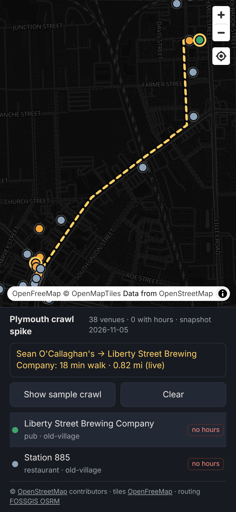

# Plymouth crawl: maps, routing and venues spike

Throwaway engineering spike for the Plymouth, MI pub crawl demo. It proves out the free data stack:
real OpenStreetMap venues on a MapLibre map, plus walking routes between them.

```bash
npm install
npm run dev            # http://localhost:5173 (add ?debug to expose window.map)
npm run fetch:venues   # refresh src/data/venues.json from Overpass (run from a home connection)
npm run fetch:routes   # refresh src/data/routes.json (walking matrix + sample crawl) from OSRM
```

Needs Node 22.18+ (the scripts import `src/osm.ts` directly).

## What's here

| Piece | Source | Notes |
|---|---|---|
| Base map | [OpenFreeMap](https://openfreemap.org) `dark` style, MapLibre GL 6 | Free, no key, no stated rate limit |
| Venues | OSM via Overpass (`fetch:venues`), falling back to OSM POIs read from the vector tiles | Snapshot in `src/data/venues.json`; app loads live if the snapshot is empty |
| Walking routes | FOSSGIS OSRM foot router, `routing.openstreetmap.de/routed-foot` | Matrix precomputed; tap two venues for a live route |

- `src/osm.ts`: shared venue normalisation (vibe, zone), Overpass fetch, OSRM route/table calls, sample-crawl ordering.
- `src/main.ts`: the map, venue list, live route and sample crawl.
- `scripts/venues-from-tiles.mjs`: builds the snapshot from tile POIs when Overpass is unreachable (how the current snapshot was made).



Data © OpenStreetMap contributors (ODbL). Attribution is shown in the app.
